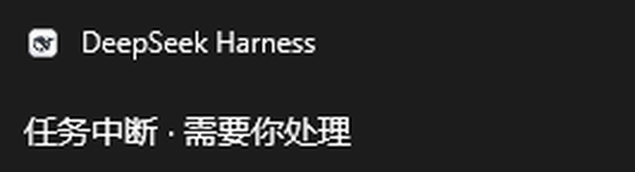

# dsh-desktop-toast

A DeepSeek Harness plugin that pops a native desktop notification when a task is **interrupted** (waiting on your approval, your answer, or a plan confirmation) or **finished** — so you do not have to babysit the window.

> Successor of the `dsh-desktop-notify` 0.1.0 prototype (which copied files into a profile via `install.ps1`). This release is a proper bundle: install, configure and remove through the official plugin manager. The name changed because `dsh-desktop-notify` is already published by someone else.



## When it fires

| Session event | Notification | Notes |
| --- | --- | --- |
| `tool/call` with `ask_user_question` / `exit_plan_mode` | 任务中断 · 需要你处理 | the model waits for your answer or plan approval |
| `approval/asked` | 任务中断 · 需要你处理 | an action waits for authorization |
| `turn/end` with `reason.kind === 'completed'` | 任务完成 | |
| `turn/end` with `reason.kind` `blocked` / `error` / `max-tokens` | 任务中断 · 需要你处理 | needs a look before it can continue |
| `turn/end` with `reason.kind === 'aborted'` | nothing | you cancelled it yourself |

Subagent sessions are ignored entirely, so one task never turns into a notification storm.

## Install

Official route — same as any other plugin:

```powershell
dsh plugin --profile desktop add dsh-desktop-toast

# or point at a local checkout while developing
dsh plugin --profile desktop add D:\code\dsh-notify\dsh-desktop-toast
```

Or use the DSH desktop app: sidebar → Plugins → install `dsh-desktop-toast`. Takes effect immediately, no restart.

**Manual fallback (not recommended):** copy the two lines under `insert` in `cordis.patch.yml` into `%USERPROFILE%\.dsh\profiles\<profile>\cordis.patch.yml`, keeping the row `id` unique.

## Configuration

Override `config` on the row in the profile's `cordis.patch.yml` (restart DSH to apply):

```yaml
- id: desktop-toast
  name: dsh-desktop-toast
  config:
    onDone: false
    dedupeWindowMs: 5000
```

| Key | Default | Meaning |
| --- | --- | --- |
| `onInterrupt` | `true` | send "task interrupted" notifications |
| `onDone` | `true` | send "task finished" notifications |
| `silent` | `false` | no notification sound (on Windows) |
| `dedupeWindowMs` | `3000` | at most one notification of each kind per window (`0` disables) |
| `bootQuietMs` | `3000` | swallow "finished" toasts right after load, so startup does not spam; interrupts still fire |
| `interruptText` | `任务中断 · 需要你处理` | interrupted body text |
| `doneText` | `任务完成` | finished body text |
| `appId` | `com.deepseek.dsh` | Windows AUMID; defaults to reusing DSH's own identity |

**Why is there no form in Settings?** This `Config` only validates and supplies defaults; the DSH Plugins page does not render schema-driven forms. A bundle's own configuration area (`plugins.bundle.config`) is filled by the bundle's own web-side code, and this is a host-only plugin — so configuration goes through `cordis.patch.yml`.

## Platforms

- **Windows (primary):** PowerShell 5.1 + WinRT `ToastNotificationManager`, so toasts appear as DeepSeek Harness in the notification centre. Needs notifications enabled for the app.
- **macOS:** `osascript -e 'display notification ...'`, best effort, attributed to Script Editor.
- **Linux:** `notify-send`, requires libnotify.

## Known limitations

- On Windows the body is a single line; no title is set, the system shows the app name.
- Each toast spawns a PowerShell process (a few hundred ms), already `unref()`d so it never holds the host open.
- Clicking a toast does not focus the session (that needs a registered COM activator on the host side).
- Host-side session events only; a pure client (browser-attached) session gets no system toast.

## Development

```powershell
cd D:\code\dsh-notify\dsh-desktop-toast
npm install          # only for the test run: @deepseek-ai/schemastery
npm test             # node --test test
npm pack --dry-run   # inspect the published file list
```

To try a change locally, install from the directory as shown above, then send a message or trigger a question.

## License

MIT
